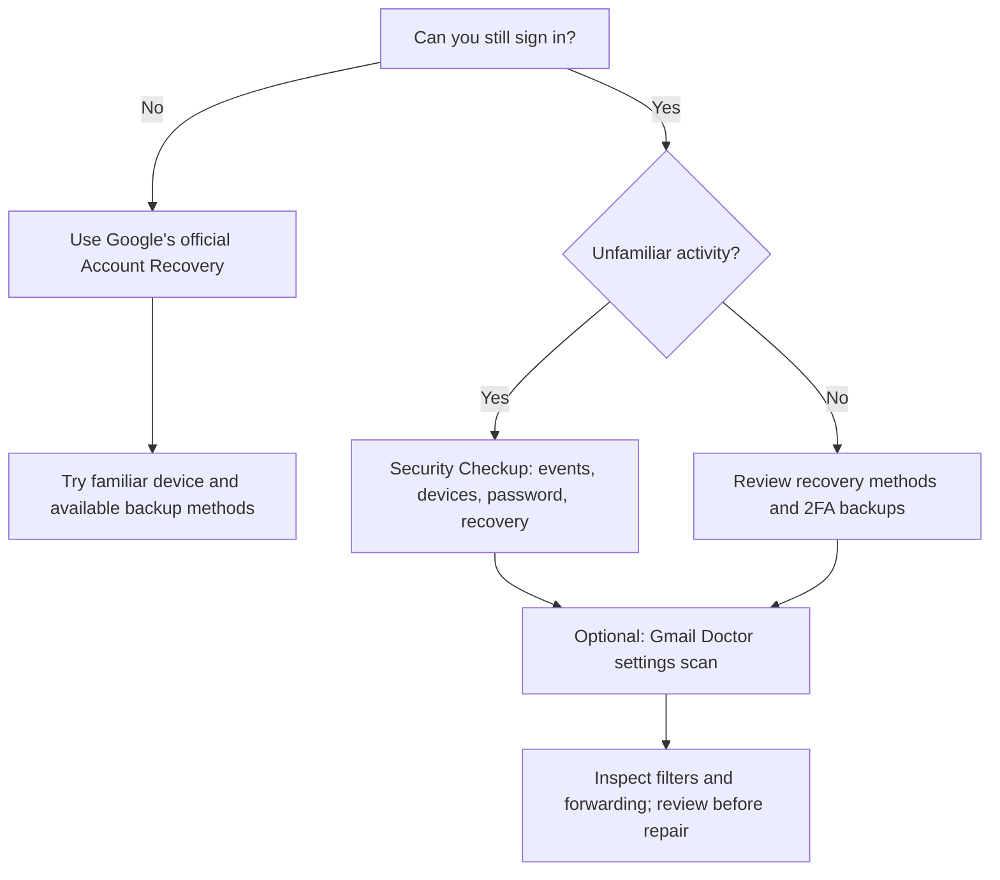

<div align="center">


# Gmail Doctor

**Know what to do when your Gmail account is at risk.**

[](https://github.com/hkalbertkim/gmail-doctor/releases)
[](LICENSE)


**Triage → Official guidance → Optional Gmail settings audit**

[Start here](#start-here--quick-triage) · [Prevent lockout](#prevent-lockout-before-it-happens) · [Run the CLI](#run-gmail-doctor) · [What it can do](#what-gmail-doctor-can-and-cannot-do) · [Privacy](docs/PRIVACY.md)

</div>

> **If you're locked out:** Gmail Doctor **cannot bypass Google sign-in, 2-Step Verification, or account recovery**. Start with [Google's official Account Recovery](https://accounts.google.com/signin/recovery). Never pay someone claiming they can recover your account by asking for passwords or verification codes.

## Start here — quick triage

**First question: Can you still sign in to your Google Account?**

| Your situation | Priority | Do this first |
| --- | --- | --- |
| I cannot sign in; my password or recovery details may have changed | **URGENT** | [Google Account Recovery](https://accounts.google.com/signin/recovery), preferably on a familiar device and network |
| I know my password but lost my 2FA phone or security key | **URGENT** | Choose **Try another way**. Check saved backup codes, another signed-in device, registered passkeys or security keys; otherwise use [official recovery](https://accounts.google.com/signin/recovery) |
| I can sign in but see unfamiliar devices or security alerts | **URGENT** | On a trusted device, run [Google Security Checkup](https://myaccount.google.com/security-checkup); review events, signed-in devices and recovery methods |
| I can sign in but my Gmail filters or forwarding look strange | **REVIEW** | Secure the Google account first, then [scan Gmail settings](#run-gmail-doctor) and inspect suspicious rules |
| Nothing is wrong yet; I want to avoid losing access | **PREVENT** | Complete [the lockout-prevention checklist](#prevent-lockout-before-it-happens) |

**Triage describes what to do next, not the probability of recovery.** A Google Account may still be recoverable even if an attacker changed 2FA or recovery information. Outcomes depend on Google's identity verification; no third-party CLI can guarantee them.

### Decision guide



### What if an attacker already controls 2FA?

**Don't assume recovery is impossible.** Google documents alternative recovery factors including previously saved backup codes, other signed-in devices, backup security keys and passkeys. If these are unavailable, use the [official recovery process](https://accounts.google.com/signin/recovery). Google may need additional time to verify ownership, and success is not guaranteed.

Official references:
- [Recover a Google Account](https://support.google.com/accounts/answer/7682439)
- [Secure a hacked account](https://support.google.com/accounts/answer/6294825)
- [Fix common 2-Step Verification problems](https://support.google.com/accounts/answer/185834)

## Prevent lockout before it happens

Use this checklist **while you still control your account**, ideally on a trusted device:

- [ ] Use a unique, strong password or suitable passkey and protect the devices that store it.
- [ ] Enable [2-Step Verification](https://myaccount.google.com/signinoptions/two-step-verification) if appropriate.
- [ ] **Set up more than one independent sign-in/recovery option** so losing a phone does not leave you with no alternative.
- [ ] Download and store [Google backup codes](https://support.google.com/accounts/answer/1187538) securely **outside the account**. Never share or paste them into this project.
- [ ] Verify your recovery email and phone in [Google Account Security](https://myaccount.google.com/security).
- [ ] Review signed-in devices, recent security events and connected third-party apps in [Security Checkup](https://myaccount.google.com/security-checkup).
- [ ] Check Gmail's forwarding and filters; use a settings audit if you suspect changes.
- [ ] If you suspect malware or session theft, secure the device as well as the account; changing passwords on an infected device may be insufficient.

**Important:** This checklist is guidance, not an automated security certification. Google security pages, not the Gmail API, control login sessions, 2FA and recovery options.

## Run Gmail Doctor

Gmail Doctor is a local-first CLI that audits available Gmail settings across connected accounts. **The audit can help while you still have access; it cannot recover a locked account.**

Requires **Node.js 20+ and macOS Keychain** for the current local token store.

```bash
git clone https://github.com/hkalbertkim/gmail-doctor.git
cd gmail-doctor
npm ci
npm link

# Start interactive Gmail Doctor; select Emergency Help from the menu:
gmail-doctor

# Try a safe synthetic Gmail settings scan:
gmail-doctor scan --demo

# Optional: print Emergency Help directly without connecting an account:
gmail-doctor triage
```

### Connect an account (developer preview)

**Public Google OAuth verification is pending.** There is currently **no one-click public sign-in**. To use Gmail Doctor with a real account you need your own Google Cloud Desktop OAuth client, Gmail API enabled and approved test-user access.

1. Open [Google Cloud Console](https://console.cloud.google.com/) and create or choose a project.
2. Enable the **Gmail API**; configure OAuth consent and register yourself as a test user if in Testing mode.
3. Create a **Desktop app** OAuth client. Save its downloaded JSON outside this repository.
4. In your own terminal, run:

```bash
gmail-doctor setup --client ~/Downloads/your-desktop-oauth.json
gmail-doctor account add --account you@gmail.com
gmail-doctor scan --all
```

Google handles sign-in and consent. **Do not enter your Google password, backup codes or recovery codes into Gmail Doctor.**

### Commands

```text
gmail-doctor                          Current interactive menu
gmail-doctor triage                   Emergency guidance (also inside the app)
gmail-doctor scan --demo              Offline fictional demo
gmail-doctor scan --all               Scan connected Gmail accounts
gmail-doctor scan --account EMAIL     Scan a specific account
gmail-doctor scan --account EMAIL --json  Machine-readable scan
gmail-doctor account add --account EMAIL  Connect an account
gmail-doctor account list             List accounts
gmail-doctor repair --account EMAIL --dry-run  Preview possible changes
gmail-doctor repair --account EMAIL   Interactive, explicitly approved deletion
gmail-doctor baseline save --account EMAIL  Save reviewed trusted filter baseline
gmail-doctor baseline check --account EMAIL  Check filter configuration drift
gmail-doctor logout --account EMAIL   Remove local token
```

## What Gmail Doctor can and cannot do

| Capability | Current status |
| --- | --- |
| Explain official recovery and prevention pathways | **Yes — guidance** |
| Audit Gmail filters, forwarding rules, aliases and available settings | **Yes — with account authorization** |
| Audit multiple connected accounts | **Yes** |
| Detect changes against a previously reviewed filter baseline | **Yes** |
| Preview filter deletions and save a local settings backup | **Yes** |
| Delete **individually selected** filters | **Yes — only after typing `REPAIR`** |
| Automatically undo deleted filters | **No** |
| Read Google login sessions, 2FA or recovery configuration through Gmail API | **No** |
| Recover locked accounts, bypass 2FA or prove an account is safe | **No** |

**Scans are not proof of compromise.** Legitimate rules may look unusual. Conversely, a clean Gmail settings scan does not rule out account takeover.

### Safety of repair

The tool only deletes explicitly selected Gmail filters after review and confirmation. It rescans before deleting and saves a local settings backup. **Backups do not currently provide automatic rollback.** Do not delete an unfamiliar rule until you understand its purpose.

The requested Gmail OAuth scope is `gmail.settings.basic`, which can change settings; it is **not read-only**. Normal scans do not intentionally change Gmail settings.

## Development and terminal UX

The current default interactive experience is a menu-based CLI with Emergency Help available from its main menu. Work on a Codex-inspired Rust terminal UI is isolated under [experiments/codex-tui-spike](experiments/codex-tui-spike) and is **not yet production-ready**. We will not claim Codex visual or behavioral parity until real macOS Terminal testing succeeds. Scanning and repair logic are preserved during this work.

For technical context see [TUI acceptance gates](docs/CODEX_TUI_SPIKE.md) and [real user problem reports](docs/REDDIT_USER_REPORTS.md).

## Privacy and project information

- Gmail message bodies and attachments are **not read**; this is a settings auditor.
- Sign-in occurs through Google OAuth, not through Gmail Doctor's own password form.
- OAuth refresh tokens are stored locally in **macOS Keychain**. Local configuration, account identifiers, baselines and backups remain on the device.
- No Gmail Doctor-hosted mailbox backend is required, though Google's OAuth and Gmail API endpoints are contacted.
- Do not post personal account data, tokens or backup codes in [public issues](https://github.com/hkalbertkim/gmail-doctor/issues).

[Privacy Policy](docs/PRIVACY.md) · [Terms of Use](docs/TERMS.md) · [MIT License](LICENSE)

```bash
npm test
npm run check
```

This independent project is not affiliated with, sponsored by, or endorsed by Google. Gmail is a trademark of Google LLC.
