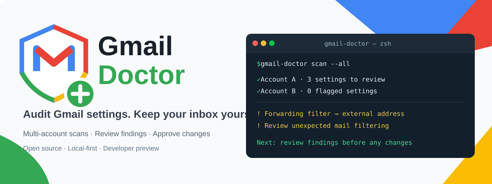

<div align="center">



# Gmail Doctor

**Check Google Account security. Audit Gmail settings. Fix what you can.**

[](https://github.com/hkalbertkim/gmail-doctor/releases)
[](LICENSE)


A local-first, open-source terminal tool for reviewing Gmail forwarding rules, potentially risky filters, and settings across multiple Google accounts.

[Quick start](#quick-start) · [Connect Gmail](#connect-your-google-account) · [Safety](#security-and-limitations) · [Privacy](docs/PRIVACY.md) · [Terms](docs/TERMS.md)

</div>

> **Developer Preview.** Google OAuth verification is pending. Connecting your own account currently requires a Google Cloud **Desktop OAuth client** and approved test access. No public one-click sign-in yet.

## Account Takeover Check — start here

**Inspired by real Gmail account-takeover reports.** People have reported losing access after an attacker changed sign-in devices, recovery details, or Family Link supervision. Read the original discussions and learn what we can and cannot address in [Real Reddit user reports](docs/REDDIT_USER_REPORTS.md).

Run `gmail-doctor` (or `gmail-doctor takeover-check`): connected accounts are **automatically scanned first**, followed by a single consolidated checklist of Google security items that cannot be checked through Gmail API. The tool guides you through:
- **Two-Step Verification (2FA) first:** Open Google's official settings, check whether it is on, and enable it there if needed. Gmail Doctor **cannot read or toggle the 2FA setting itself**.
- Review recent security events, unfamiliar signed-in devices, recovery options, and connected apps through Google.
- Record what you personally reviewed. Unchecked items are **not** shown as safe.
- If locked out, use [Google Account Recovery](https://accounts.google.com/signin/recovery).

This is a **manual, guided account security review**, not automated account takeover detection or recovery. Never enter passwords, passkeys or backup codes into Gmail Doctor.

## What it does

| Capability | Supported today |
| --- | --- |
| Guided Account Takeover Check, including 2FA setup links | Yes, **manual Google review** |
| Scan multiple connected Gmail accounts | Yes |
| Identify mail-forwarding filters and filters that trash or hide messages | Yes |
| Review sender aliases, POP/IMAP, and configured forwarding addresses | Yes |
| Keyboard-driven interactive terminal dashboard | Yes |
| Delete **selected** Gmail filters after explicit approval | Yes |
| Save a local settings backup before deletion | Yes |
| Restore filters automatically from backup | **Not yet** |
| Detect stolen logins, unknown sessions, Family Link or compromised recovery info | **No** |

**A warning is not proof of hacking.** Legitimate forwarding rules can be flagged. Confirm who created a rule before removing it. Gmail Doctor cannot recover a locked-out Google account.

## Quick start

Node.js 20+ is required. The current credential store uses **macOS Keychain**.

```bash
git clone https://github.com/hkalbertkim/gmail-doctor.git
cd gmail-doctor
npm ci
npm link

# Run without connecting to Gmail
gmail-doctor scan --demo

# Open the interactive terminal dashboard
gmail-doctor
```

The demo uses fictional settings; it never logs into Google or modifies an account.

## Connect your Google account

Until Google approves the public OAuth application:

1. Create/select a project in [Google Cloud Console](https://console.cloud.google.com/).
2. Enable the **Gmail API** and configure the OAuth consent screen (External / Testing for your test accounts).
3. Register your email as an approved **Test user**.
4. Create a **Desktop app** OAuth client and download its JSON **outside** this repository.
5. Configure the CLI once:

```bash
gmail-doctor setup --client ~/Downloads/your-desktop-oauth.json
gmail-doctor account add --account you@gmail.com
gmail-doctor account list
gmail-doctor scan --all
```

To add more accounts, register them as permitted OAuth test users, then repeat `gmail-doctor account add --account other@example.com`. Google opens the browser for consent; **never enter your Google password in Gmail Doctor**.

## Interactive scanning and repair

Run `gmail-doctor` for an interactive dashboard. Arrow keys navigate, Space selects checkboxes, Enter advances.

The repair flow is deliberately explicit:

1. Choose an account and review the findings.
2. Select only filters **you intend to delete**.
3. Inspect the repair plan; type `REPAIR` to confirm.
4. The CLI rechecks the selected filters, saves a local settings backup, applies authorized deletions, and rescans.

You can inspect a repair plan without making changes:

```bash
gmail-doctor repair --account you@gmail.com --dry-run
```

**Warning:** Deleting a filter can disrupt expected workflows. Gmail Doctor currently **cannot automatically restore a deleted filter**. A settings backup does not mean rollback is available. Do not select rules you recognize and need.

## CLI reference

```text
gmail-doctor                                    Interactive dashboard
gmail-doctor scan --demo                        Safe sample scan
gmail-doctor account add --account EMAIL        Connect another account
gmail-doctor account list                       List registered accounts
gmail-doctor scan --all                         Scan all connected accounts
gmail-doctor scan --account EMAIL               Scan one account
gmail-doctor scan --account EMAIL --json        Structured output
gmail-doctor repair --account EMAIL --dry-run   Review, no writes
gmail-doctor repair --account EMAIL             Explicitly approve changes
gmail-doctor logout --account EMAIL             Remove local token
```

## Security and limitations

- Reads Gmail **settings**, not message bodies or attachments.
- Uses Google's OAuth sign-in; never collects Gmail passwords.
- Stores refresh tokens in macOS Keychain; account IDs and settings backups remain on the local machine.
- Sends no mailbox content to a Gmail Doctor backend; network requests to Google are necessary for OAuth and Gmail API.
- OAuth scope `gmail.settings.basic` can **modify** Gmail settings; it is **not a read-only scope**.
- Does not scan sign-in sessions, stolen cookies, recovery options, Google Family Link or third-party OAuth grants.
- A clean scan of available settings **does not prove the account is safe**.
- Some setting changes require manual action in [Gmail Settings](https://mail.google.com/mail/u/0/#settings/general) or [Google Security Checkup](https://myaccount.google.com/security-checkup).

Security concerns: open a [GitHub issue](https://github.com/hkalbertkim/gmail-doctor/issues) without posting email addresses, OAuth tokens, or personal mailbox data.

## Privacy, terms and contributing

[Privacy Policy](docs/PRIVACY.md) · [Terms of Use](docs/TERMS.md) · [MIT License](LICENSE)

Run the checks before contributing:

```bash
npm ci
npm test
npm run check
```

This project is **independent**, and is not affiliated with, sponsored by, or endorsed by Google. Gmail and the Gmail logo are trademarks of Google LLC.

## Trusted filter baseline (experimental)

Inspired by [gmailctl](https://github.com/mbrt/gmailctl)'s declarative filter comparison workflow. Only record a trusted baseline **after manually reviewing every existing Gmail rule**. The scanner will continue to flag unusual rule types; the baseline separately highlights changes to your accepted configuration.

```bash
gmail-doctor baseline save --account you@gmail.com
gmail-doctor baseline check --account you@gmail.com
```

The comparison includes filter criteria and actions, excludes Gmail's opaque filter ID, and stores local SHA-256 fingerprints in `~/.gmail-doctor/baselines`. A change is reported as added/removed fingerprints; it is not proof of malicious behavior. Saving again replaces the previous trusted baseline; retain a copy if you need history. No Gmail changes are made. The check exits with status 2 when a change is detected.

Implementation references: [gmailctl](https://github.com/mbrt/gmailctl) (MIT) and [GAMADV-XTD3 filter documentation](https://github.com/taers232c/GAMADV-XTD3/wiki/Users-Gmail-Filters). No third-party source code was copied.

## v0.7 automatic-first dashboard

Running `gmail-doctor` immediately scans every connected account for Gmail settings risks and compares any locally stored trusted baseline. After the scan it displays one summary of additional checks that **must be reviewed directly with Google** (2-Step Verification, security events, devices, recovery settings and third-party access). It never silently assumes those unverified categories are safe. It performs no automatic repair. The interactive menu remains available after the initial scan.

## Guided progress (v0.7.1)

Launching Gmail Doctor now shows three workflow stages: (1) connected accounts, (2) automatic Gmail settings scan and trusted baseline comparison for each account in order, and (3) Google security review. The current account and scan number are displayed. Google Account login sessions, 2FA status, recovery methods and connected apps cannot be inspected via Gmail API and remain NOT VERIFIED until the owner reviews official Google security pages. Scanning never changes Gmail settings.

## Command dashboard (v0.8)

Run `gmail-doctor` to open a terminal dashboard with a bordered status header, recent scan results, and a command input box at the bottom. It automatically scans connected accounts on launch without modifying Gmail settings. Supported commands: `/scan`, `/accounts`, `/security`, `/review`, `/help`, `/quit`. `/review` gives the explicit legacy repair command; it never deletes a filter directly. `gmail-doctor scan --all` and `--json` remain available for noninteractive automation. Google login sessions and two-factor authentication status are not accessible through Gmail API and remain unverified.

## Fixed-screen terminal interface (v0.8.2)

The interactive dashboard runs in a terminal alternate screen so normal terminal scrollback does not move the command prompt. The results window is independently paginated using Up/Down and PageUp/PageDown when the command input is empty, while the bottom input stays visible. Exiting restores the original terminal screen. Mouse-wheel scrolling inside the results pane is not yet supported. The noninteractive `scan --all` and `--json` commands remain unchanged.

### Terminal mouse-wheel support (v0.8.3)

On terminals supporting xterm SGR mouse reporting, Gmail Doctor captures wheel-up/down and scrolls the RESULTS viewport rather than terminal scrollback. The input box remains on screen. Arrow keys and PageUp/PageDown also work. Mouse reporting is disabled on exit. Terminal applications can have different scrollback settings; if your terminal still scrolls its history, try the keyboard controls and report the terminal name/version.

## Inline terminal mode (v0.9)

The interactive CLI now uses terminal scrollback (Ink Static) rather than taking over the alternate screen. Previous output remains in the terminal history and new results append at the bottom above a compact live command composer. The commands `/security` and `/2fa` open the corresponding **official Google pages** in your default browser. Google account security checks remain manual and NOT VERIFIED until you complete them with Google. No automatic filter repair was added.
